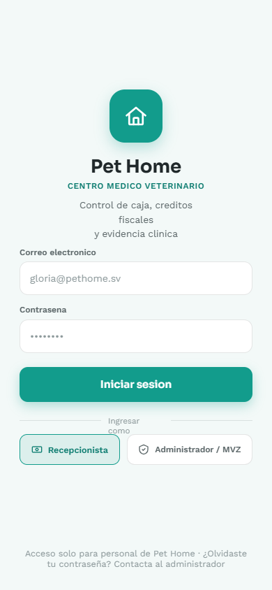
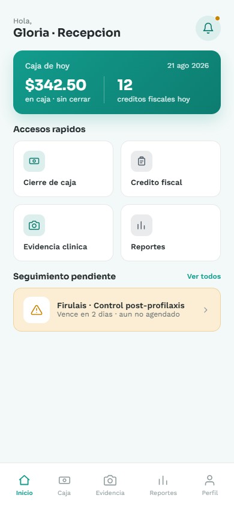
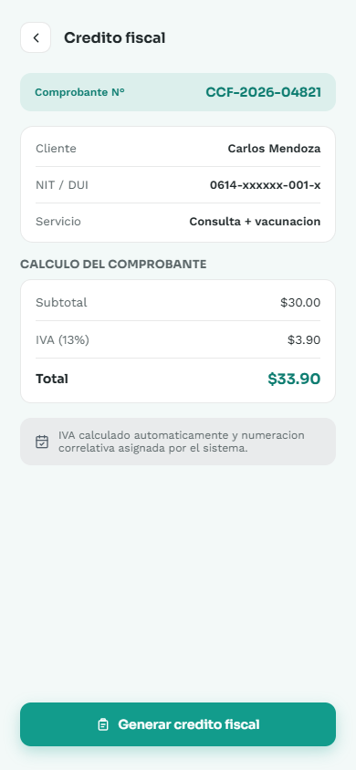
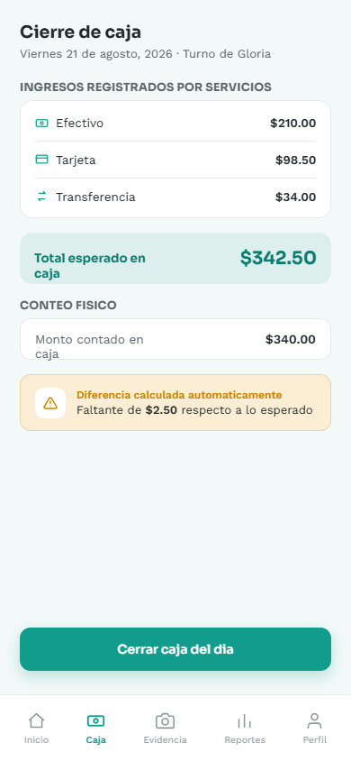
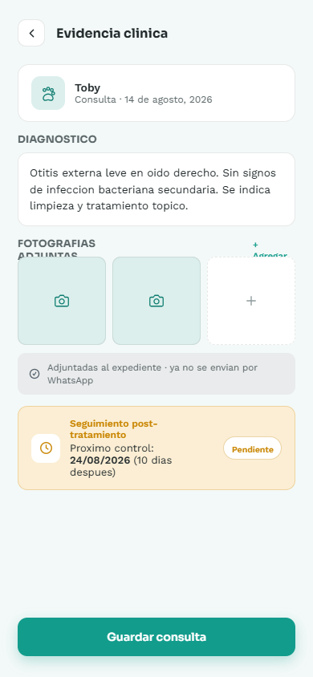
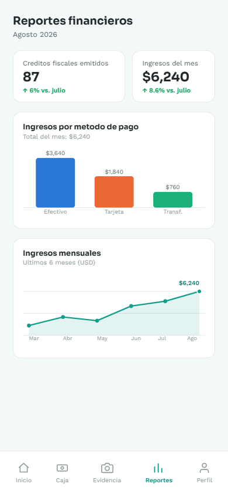

# Pet Home — App de gestión interna para un centro veterinario

[](https://creativecommons.org/licenses/by-nc-sa/4.0/deed.es)

**Proyecto de Cátedra DSM941 · Universidad Don Bosco · Equipo PremierCoders (T-036) · Ciclo II 2026**

Aplicación Android hecha en Kotlin con Jetpack Compose y Firebase para el personal de
**Pet Home, Centro Médico Veterinario** (San Salvador), una clínica real con 10 años de
operación, 15 empleados y entre 30 y 50 pacientes por semana. La app **no es para
clientes**: la usan la recepción y los veterinarios dentro de la clínica.

---

## El problema

Pet Home ya usa **VetPraxis** para la agenda, el expediente clínico y los recordatorios
de vacunación, y funciona bien. En la entrevista con el personal (Etapa 1) aparecieron
tres tareas que quedan fuera de ese sistema y se hacen a mano:

1. **Cierre de caja y créditos fiscales en Excel.** No se calcula el IVA (13 %) de forma
   automática, la numeración de los créditos se lleva a mano y no se concilia el total
   del día contra el efectivo contado.
2. **Evidencia clínica dispersa.** Las fotos de heridas y exámenes se envían al WhatsApp
   personal de la veterinaria y no quedan ligadas al paciente.
3. **Seguimiento post-tratamiento inconsistente.** Hay pacientes que no vuelven a su
   control (por ejemplo, después de una profilaxis dental) y nadie se entera a tiempo.

## La solución

Pet Home complementa a VetPraxis (no lo reemplaza) con cinco módulos que trabajan sobre
datos en la nube, compartidos y actualizados en tiempo real entre todos los dispositivos
de la clínica.

| Módulo | Qué resuelve |
|---|---|
| **Cierre de Caja** | Suma efectivo, tarjeta y transferencia, lo compara con el conteo físico y marca el sobrante o faltante. Historial filtrable por día, semana y mes. |
| **Créditos Fiscales** | Calcula el IVA del 13 %, pide NIT/NRC con formato válido y asigna un correlativo `CCF-AAAA-####` sin saltos ni repetidos. Un crédito emitido no se borra: solo se anula. |
| **Evidencia Clínica** | Registra el diagnóstico del paciente y le adjunta fotos que se suben a la nube (Cloudinary). |
| **Seguimiento** | Calcula la fecha del control (procedimiento + días) y avisa qué pacientes no han regresado. |
| **Reportes** | Total en caja, ingresos por método de pago, ingresos de los últimos 7 días, IVA generado, faltantes y pacientes pendientes. |

### Roles

| Rol | Acceso |
|---|---|
| **Administrador / Veterinario (MVZ)** | Los cinco módulos. Es el único que puede eliminar cierres y anular créditos. |
| **Recepcionista / Cajero** | Cierre de Caja y Créditos Fiscales. No ve datos clínicos. |

Toda cuenta nueva empieza como Recepcionista. El rol de administrador solo se asigna
desde la consola de Firebase, y las reglas de seguridad impiden que la app lo cambie.

## Mockups

Diseño de las pantallas hecho en la Etapa 1, antes de programar la app, con la paleta
teal (#129C8C / #0D7C70) que después se usó en Jetpack Compose.

| Inicio de sesión | Panel principal | Crédito fiscal |
|:---:|:---:|:---:|
|  |  |  |
| **Cierre de caja** | **Evidencia clínica** | **Reportes financieros** |
|  |  |  |

## Tecnologías

| Área | Herramienta |
|---|---|
| Lenguaje | Kotlin 2.0.21 |
| Interfaz | Jetpack Compose (Material 3, BOM 2024.12.01) y Navigation Compose |
| Autenticación | Firebase Authentication: correo/contraseña y Google (Credential Manager) |
| Base de datos | Cloud Firestore con listeners en tiempo real, transacciones y reglas de seguridad |
| Fotos | Cloudinary (subida sin firma) y Coil para mostrarlas |
| Arquitectura | MVC con `ViewModel` |
| Compilación | Android Gradle Plugin 8.7.3, Gradle 8.11.1, minSdk 26, targetSdk 35 |

## Arquitectura

```
PetHomeAndroid/app/src/main/java/com/premiercoders/pethome/
├── modelo/        # Modelo: Usuario, CierreCaja, CreditoFiscal, EvidenciaClinica, Seguimiento
├── controlador/   # Controlador: un Gestor por módulo (Firestore) + PetHomeViewModel
├── navegacion/    # Rutas protegidas por sesión y por rol
├── util/          # Validador, mensajes de error de Firestore, formato y log de errores
└── vista/         # Vista: pantallas y componentes en Jetpack Compose
```

### Datos en Firestore

| Colección | Contenido |
|---|---|
| `usuarios/{uid}` | Nombre, correo y rol de cada persona del personal |
| `cierresCaja` | Montos del día, conteo físico, responsable y quién lo registró |
| `creditosFiscales/{CCF-AAAA-####}` | Cliente, NIT, NRC, servicio, subtotal y si está anulado |
| `contadores/creditos-AAAA` | Siguiente número del correlativo (se actualiza con una transacción) |
| `evidencias` | Paciente, diagnóstico y URL de las fotos en Cloudinary |
| `seguimientos` | Paciente, procedimiento, días para el control y estado |

Las reglas de seguridad están en [`PetHomeAndroid/firestore.rules`](PetHomeAndroid/firestore.rules):
cada colección valida los campos, el rol y que `creadoPor` sea el usuario que escribe.

## Cómo ejecutar la app

1. Clonar el repositorio y abrir **la carpeta `PetHomeAndroid`** en Android Studio
   (no la raíz).
2. Copiar `google-services.json` en `PetHomeAndroid/app/`. Se descarga desde Firebase
   Console → Configuración del proyecto → Tus apps → Pet Home Android. No se sube al
   repositorio.
3. Agregar en `PetHomeAndroid/local.properties` los datos de Cloudinary:
   ```
   cloudinary.cloudName=TU_CLOUD_NAME
   cloudinary.uploadPreset=TU_PRESET
   ```
4. Para iniciar sesión con Google, registrar la huella SHA-1 de la computadora
   (`./gradlew signingReport`) en Firebase → Tus apps → Agregar huella digital.
5. Hacer **Gradle Sync** y presionar ▶ **Run 'app'**.

La guía detallada de Firebase, Cloudinary y roles está en
[`PetHomeAndroid/README.md`](PetHomeAndroid/README.md).

## Estructura del repositorio

| Carpeta | Contenido |
|---|---|
| [`PetHomeAndroid/`](PetHomeAndroid/) | App Android final (Etapa 3) |
| [`src/`](src/) | Versión de consola en Kotlin (Etapa 2), se abre con IntelliJ IDEA desde la raíz |
| [`docs/`](docs/) | Documentos de las entregas |

## Entregas por etapa

| Etapa | Contenido | Enlaces |
|---|---|---|
| Etapa 1 — Análisis y planificación | Organización, problema, requerimientos y mockups | Documento entregado en Aula Digital |
| Etapa 2 — Desarrollo base | Lógica en Kotlin (consola) con POO, colecciones y validación | Carpeta [`src/`](src/) |
| Etapa 3 — Foro 1 | App Android con Jetpack Compose | [Video](https://www.youtube.com/watch?v=x_vHNvn7KDI) · [Documento APA 7](docs/PetHome_Foro1_JetpackCompose_Etapa3.pdf) |
| Etapa 3 — Foro 2 | Firebase Authentication, Firestore y módulos secundarios | [Video y documento](https://drive.google.com/drive/folders/1B4b_hDTzGH_dvvErGDaYmTtByyD473L0?usp=sharing) |
| Entrega final | App completa, mockups, licencia y README | Este repositorio |

## Equipo PremierCoders

| Integrante | Carnet | GitHub | Rama |
|---|---|---|---|
| Diego Carlos Nochez Gallardo | NG182027 | [@DiegoNochez](https://github.com/DiegoNochez) | `rama-diego` |
| Nelson Elías Henríquez Chávez | HC252054 | [@NelsonHC722](https://github.com/NelsonHC722) | `rama-nelson` |
| Jimmy Royer Melendez Pineda | MP251278 | [@jimmmyrmp](https://github.com/jimmmyrmp) | `rama-jimmy` |

Cada integrante trabaja en su rama y sus cambios llegan a `main` por Pull Request.

## Licencia

Este proyecto se distribuye bajo la licencia
[Creative Commons Atribución-NoComercial-CompartirIgual 4.0 Internacional (CC BY-NC-SA 4.0)](https://creativecommons.org/licenses/by-nc-sa/4.0/deed.es).
Se puede compartir y adaptar dando crédito al equipo PremierCoders, sin fines
comerciales y bajo la misma licencia. El texto completo está en [`LICENSE`](LICENSE).
